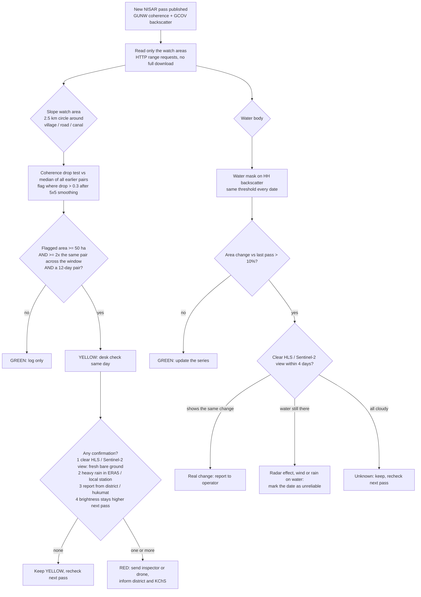
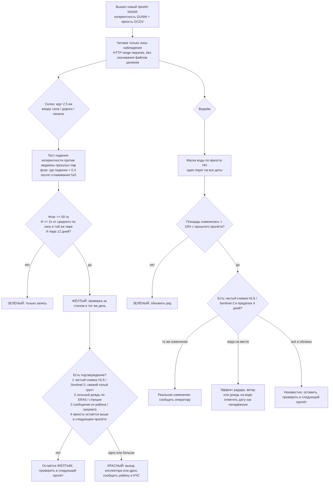

# NISAR rapid check for Tajikistan: a proposed workflow
# Быстрая проверка по NISAR для Таджикистана: предлагаемый порядок работы

> **Status: proposal by a hackathon team.** It is built on what we measured in five places in 2026 (one detected mudflow, one missed, two reservoirs, one landslide dam). It has **not** been agreed with the Committee of Emergency Situations (KChS), Barqi Tojik or the Rogun/Nurek operators, and it has not run operationally. Numbers in brackets are measured; see the project site and `scripts/false_alarm_rate.py`.
>
> **Статус: предложение команды хакатона.** Оно основано на том, что мы измерили в пяти местах в 2026 году: один обнаруженный сель, один пропущенный, два водохранилища, один завал. С КЧС, «Барки Тоҷик» и операторами Рогуна/Нурека это **не** согласовано, в работе не применялось. Числа в скобках измерены нами; подробности на сайте проекта и в `scripts/false_alarm_rate.py`.

---

## English

### What it is for
- NISAR images every place in Tajikistan about every 12 days, day or night and through cloud.
- The workflow turns each new pass into a short list of places for a person to check. It does not replace field teams.
- It answers two questions:
  1. **Slopes above villages, roads and canals:** did the ground surface change sharply since the last pass (mudflow, landslide, large erosion)?
  2. **Reservoirs and lakes (Nurek, Rogun, Sarez):** how much open water is there, and is a sudden change real or a radar effect?

### Flow

### Thresholds and why
| Step | Threshold | Basis (measured) |
|---|---|---|
| Flag pixel | coherence drop > 0.3 after 5×5 smoothing | Ayni: 0.89 → 0.44 in the event pair; result held in 27 of 27 parameter settings |
| Yellow | ≥ 50 ha in a 2.5 km circle, ≥ 2× the window average, 12-day pair | Background in five windows: 9 of 288 tests (3.1%) pass; in mountain windows without reservoirs, 1 of 50 |
| Expected load | about 3 yellow alarms per 100 watched circles per pass | 3.1% × 100 |
| Red | yellow + at least one independent confirmation | Ayni had several. A single radar flag reaches the Ayni level in about 1 of 80 background tests |
| Water check | > 10% change between passes | Rogun autumn radar dips (−30%) were not seen by Landsat 4 days earlier (90–96% of the water still there) |

### What it cannot do (tell users plainly)
- **It misses narrow flows.** Rushan (20 Jul 2026): the channel was mostly 30–40 m wide, two radar pixels or less, and ran through orchards that are always low in coherence. Radar dropped only 0.10–0.15. Narrow flows, areas under trees and very steep slopes facing away from the satellite need other sources.
- **One orbit direction can miss a slope.** At Panjakent (11 Jul 2026) only the descending orbit saw the mudflow: the slopes that changed face west, and the ascending orbits see them from behind. Run every circle on both ascending and descending orbits where available.
- **Early season and longer gaps.** Pairs at the start of summer and 24-day pairs light up whole windows. Use 12-day pairs and compare each circle with the rest of the window.
- **Not a warning before the event.** A pass every 12 days shows what changed after it happened. It helps with damage mapping, finding unreported events in remote valleys, and checking that a dam or slope did *not* change.
- **Slow movement needs phase time series.** Few centimetres a year (for example the right-bank slope at Lake Sarez) is below what single 12-day coherence pairs show.
- **Area, not level.** The water check measures open-water area, not the water level in metres.
- **Provisional data.** NISAR 2026 products are provisional; thresholds must be re-checked as processing changes.

### Who would do what
| Role | Task | Time |
|---|---|---|
| Analyst (KChS or a university partner) | Run the script after each pass, review yellow alarms with HLS / Sentinel-2 and rain | our estimate: ~1 h per pass for ~100 circles |
| District (hukumat) contact | Confirm or deny on the ground by phone | same day |
| KChS field team or drone | Visit red alarms | as needed |
| Reservoir operator | Receive water area series and the weekly flag "real change / radar effect / unknown" | every 12 days |

### Start-up steps
1. Agree the list of watch circles with KChS: villages with past mudflows, main roads (Dushanbe–Khujand, Pamir highway), main canals.
2. Run the method backwards on all 2026 passes to learn each circle's normal level (the background test above, per circle).
3. Collect every mapped event (KChS reports, Red Cross, Sentinel Asia) to measure how many are detected. Today we have Ayni (detected), Panjakent (blind test: detected on 1 of 3 orbits) and Rushan (missed), which is not enough for a detection rate.
4. Re-check the thresholds every season.

---

## Русский

### Зачем
- NISAR снимает каждое место Таджикистана примерно раз в 12 дней, днём и ночью и сквозь облака.
- Этот порядок превращает каждый новый пролёт в короткий список мест, которые должен проверить человек. Выездные группы он не заменяет.
- Он отвечает на два вопроса:
  1. **Склоны над сёлами, дорогами и каналами:** резко ли изменилась поверхность с прошлого пролёта (сель, оползень, сильный размыв)?
  2. **Водохранилища и озёра (Нурек, Рогун, Сарез):** сколько открытой воды и реально ли резкое изменение или это эффект радара?

### Схема

### Пороги и откуда они
| Шаг | Порог | Основание (измерено) |
|---|---|---|
| Флаг пикселя | падение когерентности > 0.3 после сглаживания 5×5 | Айни: 0.89 → 0.44 в паре через сель; результат держится в 27 из 27 вариантов параметров |
| Жёлтый | ≥ 50 га в круге 2.5 км, ≥ 2× от среднего по окну, пара 12 дней | Фон в пяти окнах: проходят 9 из 288 тестов (3.1%); в горных окнах без водохранилищ 1 из 50 |
| Ожидаемая нагрузка | около 3 жёлтых сигналов на 100 кругов за пролёт | 3.1% × 100 |
| Красный | жёлтый + хотя бы одно независимое подтверждение | В Айни подтверждений было несколько. Одиночный флаг уровня Айни встречается примерно в 1 из 80 фоновых тестов |
| Проверка воды | изменение > 10% между пролётами | Осенние провалы Рогуна на радаре (−30%) Landsat за 4 дня до них не видел (90–96% воды на месте) |

### Чего метод не умеет (говорить пользователям прямо)
- **Пропускает узкие потоки.** Рушан (20 июля 2026):
  - русло в основном шириной 30–40 м, это не больше двух радарных пикселей;
  - оно шло через сады, где когерентность всегда низкая;
  - радар упал всего на 0.10–0.15.
  Для узких потоков, участков под деревьями и очень крутых склонов, обращённых от спутника, нужны другие источники.
- **Одна сторона орбиты может не увидеть склон.** В Пенджикенте (11 июля 2026) сель увидела только нисходящая орбита: изменившиеся склоны смотрят на запад, а восходящие орбиты видят их со спины. Каждый круг нужно проверять и с восходящей, и с нисходящей орбиты, где они есть.
- **Начало сезона и длинные промежутки.** Первые пары лета и пары через 24 дня «загораются» по всему окну. Используем пары через 12 дней и сравниваем круг с остальным окном.
- **Это не предупреждение заранее.** Пролёт раз в 12 дней показывает, что изменилось уже после события. Метод полезен:
  - для карты ущерба;
  - для поиска событий, о которых не сообщили, в дальних долинах;
  - для проверки, что плотина или склон *не* изменились.
- **Медленное движение требует ряда фазы.** Несколько сантиметров в год (например, правый склон у Сарезского озера) отдельные 12-дневные пары не покажут.
- **Площадь, а не уровень.** Проверка воды измеряет площадь открытой воды, а не уровень в метрах.
- **Предварительные данные.** Продукты NISAR 2026 года предварительные (provisional), пороги нужно перепроверять при изменении обработки.

### Кто что делает
| Роль | Задача | Время |
|---|---|---|
| Аналитик (КЧС или университет-партнёр) | Запуск скрипта после каждого пролёта, разбор жёлтых сигналов по HLS / Sentinel-2 и осадкам | наша оценка: ~1 ч на пролёт для ~100 кругов |
| Контакт в районе (хукумат) | Подтвердить или опровергнуть на месте по телефону | в тот же день |
| Выездная группа КЧС или дрон | Выезд по красным сигналам | по необходимости |
| Оператор водохранилища | Получает ряд площади воды и отметку «реальное изменение / эффект радара / неизвестно» | раз в 12 дней |

### Первые шаги
1. Согласовать с КЧС список кругов наблюдения:
   - сёла, где уже были сели;
   - главные дороги (Душанбе–Худжанд, Памирский тракт);
   - главные каналы.
2. Прогнать метод назад по всем пролётам 2026 года, чтобы узнать обычный уровень каждого круга (фоновый тест выше, для каждого круга отдельно).
3. Собрать все задокументированные события (отчёты КЧС, Красный Крест, Sentinel Asia) и измерить, сколько из них метод находит. Сейчас у нас Айни (найден), Пенджикент (слепой тест: найден на 1 из 3 орбит) и Рушан (пропущен). Этого мало, чтобы назвать процент обнаружения.
4. Перепроверять пороги каждый сезон.
